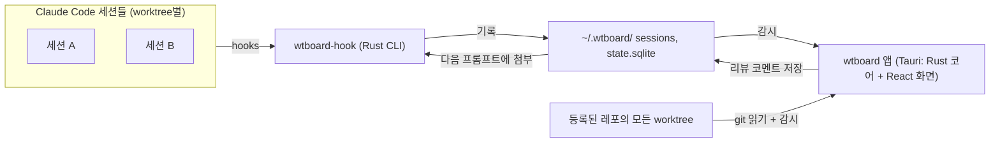
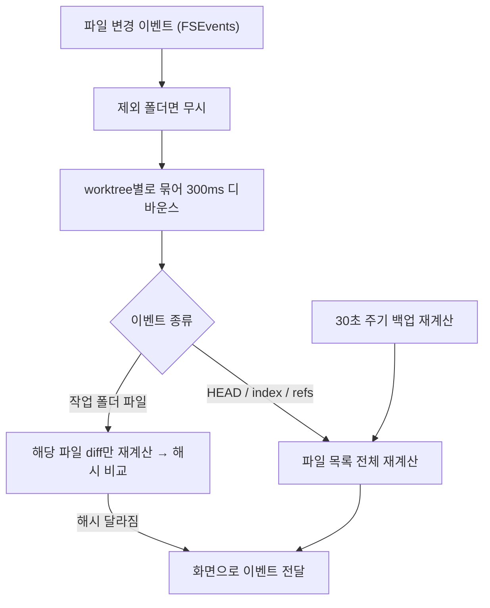

# Worktree 리뷰 보드 (가칭 wtboard) 설계

> 여러 worktree에서 Claude Code를 동시에 돌리면서, 각 worktree의 변경 사항을 GitHub PR처럼 split view로 실시간 확인하기 위한 Mac 로컬 앱.

## 0. 한 줄 요약

Tauri 로컬 앱 하나가 등록된 레포들의 모든 worktree를 감시하며 PR 스타일 diff를 보여주고, Claude Code plugin(hooks)이 세션별 변경 기록을 파일로 남겨 "이번 세션 / 마지막 응답" 뷰까지 제공한다. 서버는 없다.

## 1. 결정 사항과 이유

| 결정 | 이유 |
|---|---|
| 로컬 서버 없이 로컬 앱으로 만든다 | 필요한 능력은 `git` 실행과 파일 감시뿐. 브라우저는 이걸 못 해서 서버가 필요했던 것이고, 데스크톱 앱은 앱 프로세스가 직접 할 수 있다 |
| Tauri (Rust 코어 + React 화면) | 상시 띄워 두는 앱이라 가벼워야 함. 화면은 React로 검증된 diff 라이브러리 활용. 개발은 Claude Code로 진행하므로 언어 부담 없음 |
| git은 CLI를 직접 실행 | 터미널과 결과가 100% 같고, worktree / `.gitattributes` 처리가 정확함 |
| 레포는 직접 등록, worktree는 자동 발견 | 관심 없는 레포까지 감시하지 않으면서, worktree를 어디에 만들든 자동으로 잡힘 |
| 세션 추적은 Claude Code hooks로 | git만으로는 "이 세션이 바꾼 것"을 구분할 수 없음. hooks는 파일 단위로 정확히 알려줌 |
| hook과 앱은 파일로 통신 | hook은 짧게 실행되고 끝나는 스크립트. 앱이 꺼져 있어도 기록이 쌓이고, 서버가 필요 없음 |
| 앱은 레포에 아무것도 쓰지 않는다 | Claude Code의 git 작업과 충돌하지 않기 위함 |

## 2. 전체 구성



| 구성 요소 | 역할 |
|---|---|
| **wtboard 앱** | worktree 발견, git diff 계산, 파일 감시, 화면 표시, 리뷰 코멘트 작성 |
| **wtboard-hook** | Claude Code hook이 호출하는 작은 CLI. 세션 기록을 파일로 남기고 즉시 종료 |
| **Claude Code plugin** | hooks 설정만 담은 plugin. 사용자 단위로 한 번 설치하면 모든 레포에 적용 |

## 3. 기술 스택

| 영역 | 선택 | 이유 |
|---|---|---|
| 앱 껍데기 | Tauri 2 | 가볍고, Rust 코어와 React 화면을 한 앱으로 묶음 |
| git 읽기 | `git` CLI 직접 실행 | 터미널과 결과가 같음, worktree/attributes 처리 정확 |
| 파일 감시 | `notify` + `notify-debouncer-full` | Mac FSEvents 사용, 디바운스 내장 |
| 상태 저장 | SQLite (`rusqlite`) | 봤음 체크, 리뷰 코멘트 |
| 설정 | TOML (`toml` + `serde`) | 사람이 직접 편집하기 쉬움 |
| 해시 | `blake3` | diff 변경 여부 비교용, 빠름 |
| 화면 | React + TypeScript + Vite + Tailwind CSS | 익숙한 스택 |
| 화면 상태 | TanStack Query (Tauri 명령 결과 캐시) + Zustand (선택 상태 등) | 익숙한 조합 |
| diff 렌더링 | `react-diff-view` (+ `refractor` 하이라이팅) | split/unified 지원. 1단계에서 617개 파일 브랜치로 확인 → 확정 |
| hook CLI | Rust 바이너리 (같은 workspace) | 실행 시간 수 ms, Claude 작업을 늦추지 않음 |

## 4. 프로젝트 구조

```
wtboard/
├─ crates/
│  ├─ core/          # 도메인 + git 읽기 + diff + 프로필 (앱/hook 공용)
│  │  ├─ domain/     # Repo, Worktree, ChangeSet, FilePatch, Session
│  │  ├─ git/        # git 명령 실행 (읽기 전용 래퍼)
│  │  ├─ profile/    # FastAPI / Next / Flutter 프로필
│  │  └─ store/      # ~/.wtboard 파일, SQLite 접근
│  ├─ app/           # Tauri: 명령(command), 감시, 화면으로 이벤트 전달
│  └─ hook/          # wtboard-hook CLI
├─ ui/               # React + Vite
└─ plugin/           # Claude Code plugin
   ├─ .claude-plugin/plugin.json
   └─ hooks/
      ├─ hooks.json
      └─ run.sh      # ~/.wtboard/bin/wtboard-hook 호출, 없으면 조용히 종료
```

- `core`는 앱과 hook이 같이 쓰는 레이어.
- git 실행, 파일 저장 같은 바깥 의존은 `git/`, `store/`로 분리해서 `domain/`이 직접 알지 않게 한다.

### 도메인 모델

```
Repo (my-api)
 └─ Worktree (경로, 브랜치, HEAD sha)
     ├─ ChangeSet (base 대비 변경 파일 목록)
     │   └─ FilePatch (파일 하나의 diff, diff 해시)
     └─ Session (Claude Code 세션, turn 목록)
```

## 5. 로컬 저장소 (`~/.wtboard/`)

```
~/.wtboard/
├─ config.toml
├─ state.sqlite              # 봤음 체크, 리뷰 코멘트
├─ bin/wtboard-hook          # 앱 첫 실행 시 복사
└─ sessions/<session_id>/
   ├─ meta.json              # 시작 시각, cwd, 시작 시 HEAD, 종료 여부
   ├─ baseline/<상대경로>     # 세션에서 처음 건드리기 직전의 원본
   ├─ baseline_new.txt       # 세션 중 새로 생긴 파일 목록
   ├─ turns/<n>/<상대경로>    # 응답(turn) 종료 시점 스냅샷
   └─ events.jsonl           # 변경 이벤트 로그
```

### config.toml

```toml
[[repo]]
path = "~/dev/my-api"        # 프로젝트 종류는 자동 판별
base = "origin/main"

[[repo]]
path = "~/dev/my-web"
base = "origin/develop"

[[repo]]
path = "~/dev/my-app"        # base 생략 → gh PR base → origin/HEAD 순

[watch]
fallback_poll_secs = 30

[sessions]
keep_days = 7

[review]
auto_attach_comments = true  # 다음 프롬프트에 리뷰 코멘트 자동 첨부
```

### events.jsonl

```jsonl
{"t":"2026-10-15T14:02:11Z","kind":"edit","tool":"Edit","path":"app/api/users.py","turn":3}
{"t":"2026-10-15T14:02:40Z","kind":"bash","cmd":"dart run build_runner build","paths":["lib/user.g.dart"],"turn":3}
{"t":"2026-10-15T14:03:05Z","kind":"turn_end","turn":3}
```

## 6. 핵심 동작 ① 레포와 worktree 찾기

1. `config.toml`의 레포 목록을 읽는다.
2. 레포마다 `git worktree list --porcelain`으로 worktree를 찾는다. 어디에 만들었든 다 잡힌다.
3. `git rev-parse --git-common-dir` 아래의 `worktrees/` 폴더를 감시해서, worktree가 생기거나 지워지면 목록을 다시 읽는다.
4. 레포 루트 파일로 프로젝트 종류를 판별한다.
   - `pubspec.yaml` → Flutter
   - `package.json`에 `next` 의존성 → Next
   - `pyproject.toml`에 `fastapi` 의존성 → FastAPI
   - 판별 실패 → 기본 프로필

## 7. 핵심 동작 ② 브랜치 전체 diff (PR 뷰)

### base 결정 순서

1. `config.toml`의 `base`
2. `gh pr view --json baseRefName` (gh가 있고 PR이 있을 때)
3. `origin/HEAD`

### 계산

| 단계 | 명령 | 시점 |
|---|---|---|
| merge-base | `git merge-base <base> HEAD` | HEAD나 base가 바뀔 때만 |
| 파일 목록 | `git diff --merge-base <base> --numstat -z` + `git ls-files --others --exclude-standard -z` | 변경 감지 시 |
| 파일 하나 diff (tracked) | `git diff --merge-base <base> -- <파일>` | 화면에 보일 때 (지연 로딩) |
| 파일 하나 diff (untracked) | `git diff --no-index /dev/null <파일>` | 화면에 보일 때 (지연 로딩) |

`git diff --merge-base <base>`에 두 번째 인자를 생략하면 merge-base와 **현재 작업 트리**를 비교하므로, 커밋된 변경과 커밋 안 된 변경이 한 번에 나온다. untracked 파일만 별도로 처리한다.

### 규칙

- 모든 git 호출에 `GIT_OPTIONAL_LOCKS=0`을 붙인다. 읽기 명령이 index lock을 잡지 않게 해서 Claude Code의 git 작업과 충돌을 막는다.
- 앱은 레포에 **어떤 것도 쓰지 않는다** (index, 객체, 설정 전부).
- 바이너리 파일, 1MB 초과 파일은 diff 대신 "변경됨 (크기 변화)"만 표시한다.
- 생성/lock 파일은 접어서 표시한다. 판단 기준은 프로필 규칙 + `.gitattributes`의 `linguist-generated` (`git check-attr`로 확인). GitHub PR과 같은 기준이 된다.

### 프로젝트 프로필

| 프로필 | 감시 제외 폴더 | 기본 접기 |
|---|---|---|
| FastAPI | `.venv`, `__pycache__`, `.pytest_cache`, `.ruff_cache`, `.mypy_cache` | `uv.lock` |
| Next | `node_modules`, `.next`, `out`, `.turbo` | `pnpm-lock.yaml`, `next-env.d.ts` |
| Flutter | `.dart_tool`, `build`, `ios/Pods`, `.fvm` | `*.g.dart`, `*.freezed.dart`, `pubspec.lock`, `Podfile.lock`, `GeneratedPluginRegistrant.*` |

## 8. 핵심 동작 ③ 실시간 감시

worktree 안의 `.git`은 폴더가 아니라 파일이고, 실제 HEAD와 index는 메인 clone의 `.git/worktrees/<이름>/`에 있다. 그래서 작업 폴더만 감시하면 커밋을 감지하지 못한다. worktree마다 세 군데를 감시한다.

| 감시 대상 | 감지하는 것 | 처리 |
|---|---|---|
| 작업 폴더 (제외 폴더 빼고) | 파일 수정 | 그 파일 diff만 다시 계산 → 해시 비교 → 달라졌으면 화면 갱신 |
| `git rev-parse --git-dir` (HEAD, index) | 커밋, stage, 브랜치 전환 | 파일 목록 전체 다시 계산 |
| common dir의 `refs/` (`objects/` 제외) | base 브랜치 fetch | merge-base부터 다시 계산 |



### 규칙

- `git status` 결과만으로 판단하지 않는다. 이미 수정된(M) 파일을 또 고치면 상태가 그대로이기 때문에, 반드시 **파일별 diff 해시**로 비교한다.
- FSEvents 이벤트 누락에 대비해 30초마다 파일 목록을 다시 계산한다.
- 큰 레포는 `core.fsmonitor=true`, `core.untrackedCache=true`를 켜도록 설정 화면에서 안내한다 (사용자가 직접 실행. 앱은 쓰지 않음).

## 9. 핵심 동작 ④ 세션 추적 (Claude Code plugin)

hook 입력은 stdin JSON으로 들어오며 `session_id`, `cwd`, `tool_name`, `tool_input.file_path` 등을 사용한다.

| hook | matcher | wtboard-hook 동작 |
|---|---|---|
| SessionStart | | `meta.json` 생성 (cwd, 시작 HEAD) |
| PreToolUse | `Edit\|MultiEdit\|Write\|NotebookEdit` | 이 세션에서 처음 건드리는 파일이면 원본을 `baseline/`에 복사. 없던 파일이면 `baseline_new.txt`에 추가 |
| PostToolUse | `Edit\|MultiEdit\|Write\|NotebookEdit` | `events.jsonl`에 edit 이벤트 추가 |
| PreToolUse | `Bash` | `git status` + 변경 파일 수정 시각 스냅샷 저장 |
| PostToolUse | `Bash` | 스냅샷과 비교해 새로 바뀐 파일 기록 (아래 참고) |
| Stop | | 그 응답에서 건드린 파일 스냅샷을 `turns/<n>/`에 저장, `turn_end` 기록 |
| SessionEnd | | `meta.json`에 종료 표시 |
| UserPromptSubmit | | 미전송 리뷰 코멘트가 있으면 추가 맥락으로 첨부 (11절) |

### Bash로 바뀐 파일 처리

`dart run build_runner`, `pnpm add`, `alembic revision`, `sed` 등 Edit/Write 도구를 거치지 않는 변경은 Bash hook 전후 비교로 잡는다.

- Bash 실행 전 깨끗했던 파일: `git show HEAD:<파일>`을 원본으로 저장 (정확함)
- Bash 실행 전 이미 수정돼 있었는데 원본이 없는 파일: "원본 불확실"로 표시
- 대부분 생성 파일이라 프로필 규칙으로 접힌다

### hook 원칙

- 할 일만 하고 즉시 종료한다 (목표 50ms 이내). diff 계산 같은 무거운 일은 앱이 한다.
- 어떤 오류가 나도 **exit 0**. 이 도구 때문에 Claude 작업이 막히면 안 된다.
- `run.sh`는 `~/.wtboard/bin/wtboard-hook`이 없으면 아무것도 안 하고 종료한다.
- hook 안의 git 호출에도 `GIT_OPTIONAL_LOCKS=0`을 붙인다.

### 세션 → worktree 연결

hook은 cwd만 기록하고, 앱이 cwd를 등록된 worktree 경로와 매칭한다. 같은 worktree에서 세션이 여러 개여도 `session_id`로 구분된다.

### 세션 diff 계산

- **이번 세션**: `baseline/`의 원본 ↔ 현재 파일. git과 무관하므로 세션 중 커밋해도 깨지지 않는다.
- **마지막 응답**: `turns/<n-1>/` 스냅샷(없으면 baseline) ↔ `turns/<n>/` 스냅샷. 진행 중인 응답은 현재 파일과 비교.

### hooks.json (일부)

```json
{
  "hooks": {
    "SessionStart": [
      { "hooks": [{ "type": "command", "command": "${CLAUDE_PLUGIN_ROOT}/hooks/run.sh session-start" }] }
    ],
    "PreToolUse": [
      { "matcher": "Edit|MultiEdit|Write|NotebookEdit",
        "hooks": [{ "type": "command", "command": "${CLAUDE_PLUGIN_ROOT}/hooks/run.sh pre-edit" }] },
      { "matcher": "Bash",
        "hooks": [{ "type": "command", "command": "${CLAUDE_PLUGIN_ROOT}/hooks/run.sh pre-bash" }] }
    ],
    "PostToolUse": [
      { "matcher": "Edit|MultiEdit|Write|NotebookEdit",
        "hooks": [{ "type": "command", "command": "${CLAUDE_PLUGIN_ROOT}/hooks/run.sh post-edit" }] },
      { "matcher": "Bash",
        "hooks": [{ "type": "command", "command": "${CLAUDE_PLUGIN_ROOT}/hooks/run.sh post-bash" }] }
    ],
    "Stop": [
      { "hooks": [{ "type": "command", "command": "${CLAUDE_PLUGIN_ROOT}/hooks/run.sh turn-end" }] }
    ],
    "SessionEnd": [
      { "hooks": [{ "type": "command", "command": "${CLAUDE_PLUGIN_ROOT}/hooks/run.sh session-end" }] }
    ],
    "UserPromptSubmit": [
      { "hooks": [{ "type": "command", "command": "${CLAUDE_PLUGIN_ROOT}/hooks/run.sh prompt-submit" }] }
    ]
  }
}
```

```sh
#!/bin/sh
# plugin/hooks/run.sh
BIN="$HOME/.wtboard/bin/wtboard-hook"
[ -x "$BIN" ] || exit 0
exec "$BIN" "$@"
```

## 10. 화면 구성

```
┌──────────────────┬───────────────────┬──────────────────────────────────────┐
│ 레포 / worktree   │ 파일 트리          │ [브랜치 전체] [이번 세션] [마지막 응답]  │
│                  │                   │ [split | unified]      12/18 확인함   │
│ ▾ my-api         │ ▾ app/api         │──────────────────────────────────────│
│   ● feat-auth  7 │   ☐ users.py  +40 │  users.py                   ☐ 봤음    │
│     fix-cors   2 │   ☑ deps.py   +3  │  - old line    │ + new line            │
│ ▾ my-web         │ ▾ tests           │                │ + new line            │
│   ● ui-login  12 │   ☐ test_u.py +55 │                                      │
│ ▾ my-app         │ ▸ 접힌 파일 (2)    │  💬 라인 코멘트 달기                   │
│     main      0  │                   │                                      │
└──────────────────┴───────────────────┴──────────────────────────────────────┘
```

- **사이드바**: worktree별 브랜치, 변경 파일 수, 미확인 파일 수, 활성 세션 표시(●), 마지막 변경 시각.
- **봤음 체크**: 체크 시 그 시점 diff 해시를 저장. 이후 diff가 바뀌면 자동 해제되고 "다시 바뀜" 표시.
- **탭 3개**
  - 브랜치 전체: PR 뷰 (merge-base 기준)
  - 이번 세션: 활성 세션의 누적 변경
  - 마지막 응답: 직전 turn의 변경
  - 세션이 여러 개면 탭 옆에서 세션 선택
- **접힌 파일**: 생성/lock 파일은 하단에 모아 접어 둠.
- **창 옵션**: 항상 위에 띄우기, Mac 메뉴바 아이콘에 미확인 수 표시.

## 11. 리뷰 코멘트 → Claude Code

1. 라인에 코멘트를 달면 `state.sqlite`에 worktree별로 "미전송" 상태로 저장한다.
2. 해당 worktree의 Claude Code에서 다음 프롬프트를 보내면, UserPromptSubmit hook이 미전송 코멘트를 `파일:라인 + 코드 일부 + 코멘트` 형태로 추가 맥락에 붙이고 "전송됨"으로 바꾼다.
3. 자동 첨부를 원하지 않을 때를 위해 "마크다운으로 복사" 버튼을 둔다. 자동 첨부는 `config.toml`의 `review.auto_attach_comments`로 끌 수 있다.

## 12. 앱 내부 인터페이스 (Tauri command / event)

| 종류 | 이름 | 설명 |
|---|---|---|
| command | `list_repos` | 레포 + worktree 요약 (변경 파일 수, 미확인 수, 활성 세션) |
| command | `list_files(worktree_id, view, session_id)` | 파일 목록. `view` = `branch` / `session` / `turn` |
| command | `get_patch(worktree_id, view, path, session_id)` | 파일 하나의 diff |
| command | `set_viewed(worktree_id, path, diff_hash)` | 봤음 체크 |
| command | `add_comment(worktree_id, path, line, body)` | 리뷰 코멘트 추가 |
| command | `list_sessions(worktree_id)` | 해당 worktree의 세션 목록 |
| event | `worktree-changed` | `{worktree_id, changed_paths, scope}` (scope = `file` / `list` / `base`) |
| event | `worktrees-updated` | worktree 생성/삭제 |
| event | `session-updated` | `{session_ids, worktree_ids}` |

## 13. 개발 순서

| 단계 | 범위 | 완료 기준 |
|---|---|---|
| 1 | 레포 1개, worktree 1개의 브랜치 전체 뷰 + 실시간 갱신 | Claude Code가 파일을 고치면 1초 안에 화면 diff가 바뀜 |
| 2 | 레포 여러 개 + worktree 사이드바 + 프로필 3종 | FastAPI / Next / Flutter worktree가 모두 보이고 생성 파일이 접힘 |
| 3 | 봤음 체크 + 다시 바뀜 표시 | 확인한 파일을 Claude가 고치면 자동으로 미확인 처리 |
| 4 | plugin + 세션 / 마지막 응답 탭 | 세션 탭에 이번 세션 변경만 정확히 보임, Bash 변경 포함 |
| 5 | 리뷰 코멘트 자동 첨부 + 메뉴바 | 코멘트 후 다음 프롬프트에서 Claude가 그 코멘트를 반영 |

1단계가 가장 중요하다. 읽기 전용 git 호출, 세 군데 감시, 해시 비교가 여기서 전부 검증되고, 이후 단계는 이 위에 쌓는 작업이다.

## 14. 지켜야 할 원칙 체크리스트

- [ ] 앱은 레포에 아무것도 쓰지 않는다
- [ ] 모든 git 호출에 `GIT_OPTIONAL_LOCKS=0`
- [ ] 변경 판단은 `git status`가 아니라 파일별 diff 해시
- [ ] 파일 diff는 화면에 보일 때만 계산 (지연 로딩)
- [ ] 제외 폴더는 감시 단계에서 걸러낸다
- [ ] hook은 50ms 이내, 항상 exit 0
- [ ] hook은 기록만, 계산은 앱이
